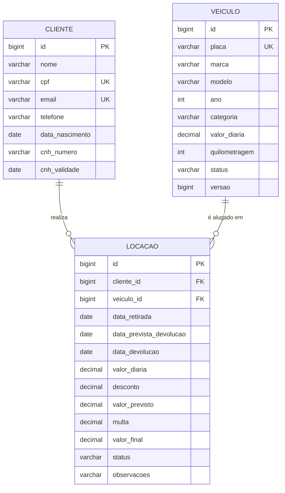

# Locadora de Veículos — API REST com Spring Boot

API REST para gestão de uma locadora de veículos: **veículos**, **clientes** e **locações**, com filtros, regras de negócio de maior complexidade, tratamento padronizado de erros HTTP, documentação Swagger e telas web que consomem a API.

> Trabalho da disciplina de **Programação Backend**.

---

## Sumário

1. [Requisitos do trabalho × onde estão atendidos](#1-requisitos-do-trabalho--onde-estão-atendidos)
2. [Tecnologias](#2-tecnologias)
3. [Como executar](#3-como-executar)
4. [Modelo de dados](#4-modelo-de-dados)
5. [Regras de negócio](#5-regras-de-negócio)
6. [Endpoints](#6-endpoints)
7. [Filtros, paginação e ordenação](#7-filtros-paginação-e-ordenação)
8. [Status HTTP e tratamento de exceções](#8-status-http-e-tratamento-de-exceções)
9. [Documentação Swagger](#9-documentação-swagger)
10. [Telas (front-end)](#10-telas-front-end)
11. [Arquitetura e estrutura de pastas](#11-arquitetura-e-estrutura-de-pastas)
12. [Testes](#12-testes)
13. [Dados de demonstração](#13-dados-de-demonstração)

---

## 1. Requisitos do trabalho × onde estão atendidos

| Requisito | Como foi atendido |
|---|---|
| Spring Boot com no mínimo 2 tabelas relacionadas | 3 tabelas: `clientes`, `veiculos` e `locacoes` (a locação se relaciona com cliente e veículo via `@ManyToOne`) |
| CRUD completo para as tabelas | `Veiculo`, `Cliente` e `Locacao`: criar, listar, buscar por id, atualizar e excluir ([endpoints](#6-endpoints)) |
| Filtragem de dados | Filtros dinâmicos combináveis com **JPA Specifications** + paginação e ordenação ([seção 7](#7-filtros-paginação-e-ordenação)) |
| Regras de negócio mais complexas | Idade mínima, CNH, disponibilidade, limite de locações, desconto progressivo, multa por atraso, taxa de devolução antecipada, controle de concorrência ([seção 5](#5-regras-de-negócio)) |
| Status HTTP e exceções tratados | `GlobalExceptionHandler` com 400/404/405/409/422/500 em formato único de erro ([seção 8](#8-status-http-e-tratamento-de-exceções)) |
| Documentação com Swagger | springdoc-openapi: `/swagger-ui.html` ([seção 9](#9-documentação-swagger)) |
| Telas conectadas ao backend | Painel web (HTML/CSS/JS) servido pela própria aplicação em `/` ([seção 10](#10-telas-front-end)) |
| README bem estruturado | Este arquivo |

---

## 2. Tecnologias

- **Java 17+** e **Spring Boot 3.3.5** (Web, Data JPA, Validation)
- **Hibernate / JPA** com **H2** em arquivo (padrão, sem instalar nada) — **PostgreSQL** opcional via perfil
- **springdoc-openapi 2.6.0** (Swagger UI)
- **JUnit 5 + MockMvc** para testes
- Front-end em **HTML, CSS e JavaScript puro** (sem build, sem dependências)

---

## 3. Como executar

### Pré-requisitos

- **JDK 17 ou superior** (`java -version`)
- **Maven 3.9+** (`mvn -version`) — ou abra o projeto no IntelliJ / Eclipse / VS Code, que já trazem o Maven embutido

### Passo a passo

```bash
# 1. entre na pasta do projeto
cd locadora-api

# 2. suba a aplicação
mvn spring-boot:run
```

Na primeira execução o banco é criado e populado com dados de demonstração automaticamente.

| O quê | Endereço |
|---|---|
| **Telas (painel web)** | http://localhost:8080 |
| **Swagger UI** | http://localhost:8080/swagger-ui.html |
| **OpenAPI (JSON)** | http://localhost:8080/v3/api-docs |
| **Console do H2** | http://localhost:8080/h2-console — JDBC URL `jdbc:h2:file:./data/locadora`, usuário `sa`, senha em branco |

### Gerar o .jar e executar

```bash
mvn clean package
java -jar target/locadora-api-1.0.0.jar
```

### Zerar o banco

Pare a aplicação e apague a pasta `data/` (criada ao lado do projeto). Na próxima execução ela é recriada com os dados de demonstração.

### Usar PostgreSQL (opcional)

```bash
# crie antes um banco chamado "locadora"
mvn spring-boot:run -Dspring-boot.run.profiles=postgres
```

Configuração em `application-postgres.properties`. Variáveis opcionais: `DB_URL`, `DB_USER`, `DB_PASSWORD`.

---

## 4. Modelo de dados



- **Categorias de veículo:** `ECONOMICO`, `INTERMEDIARIO`, `SUV`, `LUXO`, `ESPORTIVO`
- **Status do veículo:** `DISPONIVEL`, `ALUGADO`, `MANUTENCAO`
- **Status da locação:** `ATIVA`, `FINALIZADA`, `CANCELADA`
- A locação guarda um *snapshot* da diária (`valor_diaria`): reajustes futuros no veículo não alteram locações já feitas.

---

## 5. Regras de negócio

### Cadastros

| Regra | Resposta em caso de violação |
|---|---|
| CPF válido (dígitos verificadores; aceita com ou sem máscara) | `400` |
| CPF e e-mail únicos por cliente | `409` |
| Cliente com no mínimo 18 anos | `422` |
| Placa válida (padrão antigo `ABC1234` ou Mercosul `ABC1D23`), normalizada em maiúsculas e sem hífen; placa única | `400` / `409` |
| `ALUGADO` não pode ser definido manualmente (só as locações mudam esse status) | `422` |
| Veículo alugado não pode ter o status alterado manualmente | `422` |
| Quilometragem do veículo nunca pode diminuir | `422` |
| Veículo alugado ou com histórico de locações não pode ser excluído | `409` |
| Cliente com locações registradas não pode ser excluído | `409` |

### Criar locação (`POST /api/locacoes`)

| # | Regra | Violação |
|---|---|---|
| 1 | Retirada não pode estar no passado; devolução prevista deve ser posterior à retirada; período máximo de **30 dias** | `422` |
| 2 | Cliente com no mínimo **21 anos** — e **25 anos** para veículos `LUXO` e `ESPORTIVO` | `422` |
| 3 | **CNH válida até a data prevista de devolução** | `422` |
| 4 | Veículo precisa estar `DISPONIVEL` (não pode estar alugado nem em manutenção) | `422` |
| 5 | Cliente pode ter no máximo **2 locações ativas** ao mesmo tempo | `422` |
| 6 | Duas requisições simultâneas pelo mesmo carro: a segunda falha por **bloqueio otimista** (`@Version`) | `409` |

Ao criar, o veículo passa para `ALUGADO` e o **valor previsto** é calculado com **desconto progressivo**:

| Duração | Desconto |
|---|---|
| até 6 dias | 0% |
| 7 a 14 dias | 10% |
| 15 dias ou mais | 15% |

### Devolução (`POST /api/locacoes/{id}/devolucao`)

Só locações `ATIVA`; a data de devolução não pode ser futura nem anterior à retirada; a quilometragem final não pode ser menor que a atual. O **valor final** depende do cenário:

| Cenário | Cálculo |
|---|---|
| **No prazo** | valor previsto |
| **Com atraso** | valor previsto + (diária × dias de atraso) + **multa de 20% da diária por dia de atraso** |
| **Antecipada** | diárias dos dias efetivamente usados (mínimo 1, com o desconto recalculado) + **taxa de 10% da diária por dia não utilizado** |

Exemplos com diária de R$ 100,00:
- 5 dias previstos (R$ 500,00), devolvido com 5 dias de atraso → 500 + 500 + 100 de multa = **R$ 1.100,00**
- 5 dias previstos, devolvido após 2 dias → 200 + 30 de taxa (3 dias não usados) = **R$ 230,00**

Após a devolução a locação vira `FINALIZADA`, a quilometragem do veículo é atualizada e ele volta a `DISPONIVEL`.

### Outras ações

- **Cancelar** (`PATCH /api/locacoes/{id}/cancelar`): só locação ativa que ainda não começou; libera o veículo.
- **Alterar** (`PUT /api/locacoes/{id}`): só locação ativa que ainda não começou; altera data prevista e observações, **revalida** CNH/prazo e **recalcula** o valor.
- **Excluir** (`DELETE /api/locacoes/{id}`): bloqueado (`409`) para locações ativas.

---

## 6. Endpoints

### Veículos — `/api/veiculos`

| Método | Rota | Descrição | Sucesso |
|---|---|---|---|
| GET | `/api/veiculos` | Lista com filtros, paginação e ordenação | `200` |
| GET | `/api/veiculos/{id}` | Busca por id | `200` |
| POST | `/api/veiculos` | Cadastra | `201` + `Location` |
| PUT | `/api/veiculos/{id}` | Atualiza | `200` |
| DELETE | `/api/veiculos/{id}` | Exclui | `204` |

### Clientes — `/api/clientes`

| Método | Rota | Descrição | Sucesso |
|---|---|---|---|
| GET | `/api/clientes` | Lista com filtros, paginação e ordenação | `200` |
| GET | `/api/clientes/{id}` | Busca por id | `200` |
| POST | `/api/clientes` | Cadastra | `201` + `Location` |
| PUT | `/api/clientes/{id}` | Atualiza | `200` |
| DELETE | `/api/clientes/{id}` | Exclui | `204` |

### Locações — `/api/locacoes`

| Método | Rota | Descrição | Sucesso |
|---|---|---|---|
| GET | `/api/locacoes` | Lista com filtros, paginação e ordenação | `200` |
| GET | `/api/locacoes/{id}` | Busca por id | `200` |
| POST | `/api/locacoes` | Registra locação (aplica as regras) | `201` + `Location` |
| PUT | `/api/locacoes/{id}` | Altera data prevista e observações | `200` |
| POST | `/api/locacoes/{id}/devolucao` | Registra a devolução e calcula o valor final | `200` |
| PATCH | `/api/locacoes/{id}/cancelar` | Cancela a locação | `200` |
| DELETE | `/api/locacoes/{id}` | Exclui (não permitido se ativa) | `204` |

### Dashboard — `GET /api/dashboard`

Frota por status, total de clientes, locações ativas/atrasadas e receita das locações finalizadas.

---

## 7. Filtros, paginação e ordenação

Todos os filtros são **opcionais e combináveis**. A resposta paginada segue o formato:

```json
{ "content": [ ... ], "page": 0, "size": 10, "totalElements": 8, "totalPages": 1 }
```

| Recurso | Parâmetros de filtro |
|---|---|
| Veículos | `placa`, `marca`, `modelo` (busca parcial), `categoria`, `status`, `valorMin`, `valorMax` (faixa de diária) |
| Clientes | `nome`, `cpf`, `email` (busca parcial, sem diferenciar maiúsculas) |
| Locações | `status`, `clienteId`, `veiculoId`, `retiradaDe`, `retiradaAte` (`yyyy-MM-dd`), `atrasadas=true` |

Paginação e ordenação: `page`, `size`, `sort=campo,asc|desc`.

```bash
# SUVs disponíveis com diária até R$ 250, da mais barata para a mais cara
curl "http://localhost:8080/api/veiculos?categoria=SUV&status=DISPONIVEL&valorMax=250&sort=valorDiaria,asc"

# clientes com "silva" no nome
curl "http://localhost:8080/api/clientes?nome=silva"

# locações ativas que já passaram da data de devolução
curl "http://localhost:8080/api/locacoes?status=ATIVA&atrasadas=true"
```

Valores inválidos (ex.: `status=VOANDO` ou `sort=campoInexistente`) retornam `400` com mensagem clara.

---

## 8. Status HTTP e tratamento de exceções

O `GlobalExceptionHandler` (`@RestControllerAdvice`) traduz qualquer exceção em um **formato único de erro**:

| Status | Quando |
|---|---|
| `200 OK` | Consulta/atualização/ação realizada |
| `201 Created` | Recurso criado (com header `Location`) |
| `204 No Content` | Exclusão realizada |
| `400 Bad Request` | Validação de campos (lista de campos com erro), JSON malformado, enum/parâmetro/ordenação inválidos |
| `404 Not Found` | Recurso (ou rota) inexistente |
| `405 / 415` | Método HTTP ou `Content-Type` não suportado |
| `409 Conflict` | CPF/e-mail/placa duplicados, exclusão com vínculos, locação ativa, concorrência |
| `422 Unprocessable Entity` | Dados válidos, mas **regra de negócio violada** |
| `500 Internal Server Error` | Erro inesperado (detalhe só no log, nunca vaza para o cliente) |

Exemplo de erro de validação (`400`):

```json
{
  "timestamp": "2026-10-28T16:50:12.331",
  "status": 400,
  "erro": "Bad Request",
  "mensagem": "Dados inválidos: verifique os campos informados",
  "caminho": "/api/clientes",
  "campos": [
    { "campo": "cpf", "mensagem": "CPF inválido" }
  ]
}
```

Exemplo de regra de negócio (`422`):

```json
{
  "timestamp": "2026-10-28T16:51:40.902",
  "status": 422,
  "erro": "Unprocessable Entity",
  "mensagem": "Veículos da categoria LUXO exigem cliente com no mínimo 25 anos",
  "caminho": "/api/locacoes"
}
```

As exceções do domínio são `RecursoNaoEncontradoException` (404), `ConflitoException` (409) e `RegraNegocioException` (422).

---

## 9. Documentação Swagger

Com a aplicação no ar, acesse **http://localhost:8080/swagger-ui.html**.

- Endpoints agrupados por recurso (Veículos, Clientes, Locações, Dashboard)
- Cada operação descreve as regras aplicadas e os códigos de resposta possíveis
- Os DTOs trazem exemplos prontos: clique em **Try it out** e **Execute**
- O contrato OpenAPI em JSON fica em `/v3/api-docs` (pode ser importado no Postman/Insomnia)

Um arquivo com requisições prontas para demonstração está em [`docs/requests.http`](docs/requests.http) (IntelliJ HTTP Client ou extensão REST Client do VS Code).

---

## 10. Telas (front-end)

O painel é servido pela própria aplicação em **http://localhost:8080** (arquivos em `src/main/resources/static`). Como front e API estão na mesma origem, não há configuração extra.

| Tela | O que faz |
|---|---|
| **Dashboard** | Indicadores da frota, clientes, locações ativas/atrasadas e receita |
| **Veículos** | Listagem com filtros (placa, marca, modelo, categoria, status, faixa de diária), paginação, cadastro, edição e exclusão |
| **Clientes** | Listagem com filtros (nome, CPF, e-mail), cadastro, edição e exclusão; CNH vencida destacada |
| **Locações** | Listagem com filtros (status, cliente, veículo, período, atrasadas), nova locação com **prévia do preço**, edição, devolução, cancelamento e exclusão |

As mensagens de erro da API (validações `400`, regras `422`, conflitos `409`) aparecem diretamente nos formulários, com o código HTTP.

---

## 11. Arquitetura e estrutura de pastas

Arquitetura em camadas: **Controller → Service → Repository → Banco**. As regras de negócio ficam nos *services*; os controllers só recebem/validam a requisição e devolvem o status HTTP correto.

```
locadora-api/
├── pom.xml
├── README.md
├── docs/
│   ├── requests.http            # requisições prontas para a demonstração
│   └── ROTEIRO_VIDEO.md         # roteiro sugerido para o vídeo
└── src/
    ├── main/
    │   ├── java/br/com/locadora/
    │   │   ├── LocadoraApplication.java
    │   │   ├── config/          # Clock, CORS e metadados do OpenAPI
    │   │   ├── controller/      # endpoints REST + anotações Swagger
    │   │   ├── domain/          # entidades JPA e enums
    │   │   ├── dto/             # records de request/response (com validação)
    │   │   ├── exception/       # exceções do domínio + GlobalExceptionHandler
    │   │   ├── repository/      # Spring Data JPA + Specifications (filtros)
    │   │   ├── service/         # regras de negócio e CalculadoraLocacao
    │   │   ├── validation/      # @Cpf (Bean Validation)
    │   │   └── seed/            # dados de demonstração
    │   └── resources/
    │       ├── application.properties
    │       ├── application-postgres.properties
    │       └── static/          # telas: index.html, css/, js/
    └── test/                    # testes unitários e de integração
```

Decisões de projeto:

- **DTOs como `record`** com Bean Validation: a entidade nunca é exposta diretamente.
- **`CalculadoraLocacao`** isola as fórmulas de preço, sem dependência de Spring (fácil de testar).
- **`Clock` injetável**: as regras de data usam o fuso de Brasília e podem ser testadas sem depender do relógio do sistema.
- **Specifications** em vez de dezenas de métodos `findBy...`: filtros opcionais combináveis com uma única consulta.
- **`@EntityGraph`** na listagem de locações evita o problema de N+1 consultas.
- **`open-in-view` desligado**: o mapeamento para DTO acontece dentro da transação do service.
- **`@Version` em `Veiculo`**: bloqueio otimista contra locações simultâneas do mesmo veículo.

---

## 12. Testes

```bash
mvn test
```

| Classe | Tipo | O que cobre |
|---|---|---|
| `CpfUtilTest` | unitário | validação e normalização de CPF |
| `CalculadoraLocacaoTest` | unitário | desconto progressivo, multa de atraso, taxa de antecipação |
| `LocadoraApiIntegrationTest` | integração (MockMvc + H2 em memória) | validação (400), duplicidade (409), 404, filtros, criação de locação, veículo indisponível, idade mínima para categoria de luxo, CNH vencida, limite de 2 locações ativas, período máximo, devolução com atraso e antecipada, cancelamento e integridade referencial |

---

## 13. Dados de demonstração

Na primeira execução são carregados **8 veículos**, **4 clientes** e **1 locação ativa**, escolhidos para demonstrar as regras:

| Dado | Para demonstrar |
|---|---|
| **Ana Costa** (23 anos) × BMW 320i / Camaro (`LUXO`/`ESPORTIVO`) | `422` — idade mínima de 25 anos para categorias premium |
| **Pedro Lima** (CNH vencida) | `422` — CNH vencida antes da devolução |
| **Fiat Mobi** (em manutenção) | `422` — veículo indisponível |
| **Fiat Argo** (alugado por Maria da Silva) | `422` — veículo já alugado; `409` ao tentar excluir |
| **Maria da Silva** | `409` ao tentar excluir (tem locação); devolver a locação mostra o cálculo da taxa antecipada |
| CPF inválido ao cadastrar cliente | `400` com o campo `cpf` na resposta |


---

## 14. Entrega no GitHub

O repositório deve ter a pasta `src/`, o arquivo `pom.xml`, este `README.md`, o `.gitignore` e a pasta `docs/`. Não envie arquivos gerados ou dados locais, como `target/`, `data/`, configurações pessoais da IDE ou credenciais do banco.

### Publicar o projeto

Crie um repositório vazio no GitHub e, no terminal, dentro da pasta `locadora-api`, execute:

```bash
git init
git add .
git commit -m "Entrega inicial da API de locadora"
git branch -M main
git remote add origin https://github.com/SEU-USUARIO/locadora-api.git
git push -u origin main
```

Substitua `SEU-USUARIO` pelo seu usuário do GitHub. Se o projeto já estiver conectado a um repositório Git, não execute `git init` novamente. Nesse caso, confira o remoto com `git remote -v`, depois faça `git add .`, `git commit` e `git push`.

### Checklist final

- [ ] Repositório do GitHub criado e acessível ao professor.
- [ ] Código-fonte completo enviado, incluindo `src/main` e `src/test`.
- [ ] `README.md` com objetivo, tecnologias, execução, banco de dados, Swagger e exemplos de endpoints.
- [ ] `docs/requests.http` disponível para testar os principais recursos.
- [ ] Nenhuma senha, token, arquivo `.env`, pasta `target/` ou banco local foi enviado.
- [ ] Projeto executado localmente e testes verificados com `mvn test`.
- [ ] Link do repositório incluído na plataforma de entrega da disciplina.

**Link do repositório:** adicione aqui a URL do GitHub depois de publicar o projeto.
